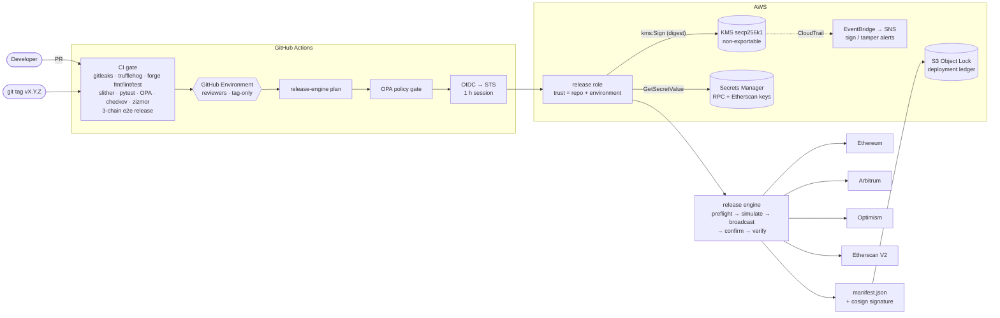

# Multi-Chain Smart Contract Release & Key Management Engine

A secure, automated pipeline that deploys the same smart contract to **Ethereum, Arbitrum and
Optimism** at **one deterministic address**. Signing happens inside an **AWS KMS HSM**, so the
key never exists in a file, env var, CI log or developer laptop. Every release is
policy-gated, verified on-chain and on Etherscan, recorded in a signed manifest, and
appended to a tamper-proof ledger.

> **Zero long-lived secrets in GitHub.** CI authenticates to AWS with OIDC, signs through KMS,
> and reads RPC/API keys from Secrets Manager at runtime. The repository's GitHub Environments
> hold only non-secret identifiers.

---

## What it does

| Capability | How |
|---|---|
| **HSM-backed signing** | secp256k1 key generated in AWS KMS (non-exportable). Foundry signs via `forge script --aws`. Ledger and a Secrets Manager break-glass path are supported too. |
| **Keyless CI auth** | GitHub OIDC → STS, with a role trusted **only** for a specific GitHub Environment (required reviewers, tag-only). 1 h sessions. |
| **Secure secret delivery** | RPC URLs and Etherscan key fetched from Secrets Manager into memory, masked (`::add-mask::` plus a redactor), and passed to child processes via env, never argv. |
| **Multi-chain, deterministic** | CREATE2 via the canonical deployer, giving the same address on every chain. Idempotent: re-runs only finish what is missing. |
| **Pre-flight safety** | RPC chain-id check, gas-price ceiling, signer pinning (`EXPECTED_DEPLOYER`), balance check and simulation before signing. |
| **Post-deploy verification** | Waits N confirmations with a reorg check. Live runtime bytecode must match the compiled artifact, `owner()` must equal the configured multisig, and source is verified via the **Etherscan V2** API. |
| **Deployment logs** | `manifest.json` + `sha256` + Markdown summary + JSONL audit log, signed keyless with **cosign** and stored in an **S3 Object Lock (WORM)** ledger. A PR records each release in git. |
| **Policy-as-code** | **OPA** gates the release plan *before* credentials are issued, and the Terraform before it merges. The same rules are built into the engine. |
| **Drift detection** | A daily job re-checks code hash, owner and pause state on every chain and opens an incident issue on drift. |
| **Detection** | EventBridge → SNS alerts on every `kms:Sign`, on key tampering (`PutKeyPolicy`, `CreateGrant`, `DisableKey`…), on secret changes and on release-role IAM changes. |

## Architecture



Per chain, the engine runs:

```
resolve RPC (secret) → eth_chainId == expected → gas ≤ ceiling → simulate (forge)
  → deployer == pinned KMS address → balance ≥ min → broadcast (KMS signs)
  → N confirmations + reorg check → runtime bytecode == artifact → owner() == multisig
  → Etherscan source verification → record
```

## Quick start (no cloud account needed)

The local demo spins up **three independent EVM chains** and runs the real engine against
them. The only requirement is Docker.

```bash
git clone --recurse-submodules <this repo> && cd <repo>
docker compose up --build --exit-code-from release      # or: make demo
```

Real output:

```
INFO    release safe-vault v1.0.0 -> profile 'local' (local-l1, local-arb, local-op) signer=anvil
INFO    [local-l1] preflight ok: chain id 31337, gas 2.000 gwei
INFO    [local-l1] simulation ok: CREATE2 -> 0xC84Fc5207886EadAF688730a7A7c0c1F16e37710
INFO    [local-l1] deployed in block 1 tx 0x6e78b46f… (702483 gas, 1 confirmations)
INFO    [local-l1] on-chain verification ok: runtime bytecode + owner match
...
## ✅ Release succeeded: `safe-vault` v1.0.0 → `local`
| Chain             | Status   | Address                                      | Bytecode | Owner |
| local-l1 (31337)  | deployed | `0xC84Fc5207886EadAF688730a7A7c0c1F16e37710` | ✅       | ✅    |
| local-arb (31338) | deployed | `0xC84Fc5207886EadAF688730a7A7c0c1F16e37710` | ✅       | ✅    |
| local-op (31339)  | deployed | `0xC84Fc5207886EadAF688730a7A7c0c1F16e37710` | ✅       | ✅    |
```

Records are written to `deployments/local/1.0.0/`: `manifest.json`, `manifest.json.sha256`,
`summary.md`, `plan.json` and `logs/<run>.jsonl`.

The safety checks also fire live. Point the "Arbitrum" RPC at the L1 node:

```
$ docker compose run --rm -e LOCAL_ARB_RPC=http://anvil-l1:8545 release release --profile local --chain local-arb
ERROR   [local-arb] PreflightError: RPC reports chain id 31337, expected 31338: refusing to sign
```

Hijack ownership on one chain, then run the drift audit:

```
ERROR   [local-arb] OWNER DRIFT: 0x3c44…93bc != released owner 0x7099…79C8
```

## Repository layout

```
contracts/            Foundry project
  src/SafeVault.sol     release artifact (pausable deposits, never-pausable withdrawals, 2-step owner)
  script/Deploy.s.sol   deterministic CREATE2 deploy, env-driven, idempotent, signer pinning
  test/                 unit + fuzz (10k runs in CI) + stateful invariants + deploy-script tests
engine/               Python release engine (stdlib-only core)
  release_engine/       config · signers · secret_store · redact · rpc · foundry · guardrails
                        bytecode · explorer · manifest · engine · cli
  tests/                69 tests with fake chain / forge / explorer doubles
infra/terraform/      KMS keys · GitHub OIDC roles · Secrets Manager · S3 WORM ledger · alerts
policy/               OPA policies + unit tests (release plan, Terraform)
.github/workflows/    ci.yml · release.yml · drift.yml
docker/               hermetic runner image (pinned Foundry + solc + hash-locked deps, non-root)
release.toml          chains, profiles, gas ceilings, confirmations: no secrets
docs/                 threat-model.md · runbook.md
```

## Security controls

| Threat | Control |
|---|---|
| Key theft | Key generated in a KMS HSM, never exportable. Engine never touches key material. |
| Rogue workflow / PR signs a tx | OIDC `sub` pinned to `repo:…:environment:<env>`. Environment reviewers + tag-only. Key policy **denies `kms:Sign` to everyone but the release role**. |
| Signing for the wrong chain | RPC `eth_chainId` check, script `block.chainid` check, EIP-155, `http://` refused for public chains. |
| Deployed code ≠ reviewed code | Clean tagged tree only. On-chain runtime bytecode diffed against artifact. Etherscan verification. LF-enforced deterministic builds. |
| Supply chain | Actions pinned by SHA, images by digest, `pip --require-hashes`, Terraform lockfile, pinned submodule, Dependabot, zizmor, harden-runner. |
| Secret leakage | Redactor + `::add-mask::`, env-not-argv, scrubbed child env. Tests assert no secret reaches logs or artifacts. |
| Admin/insider abuse | Key admins can't sign. Secrets are write-only for humans. Alerts on key, secret and role changes. |
| Record tampering | sha256 + cosign keyless signature (bound to workflow identity) + S3 Object Lock + PR-recorded history. |
| Post-deploy takeover | Daily drift audit of code, owner and pause state, opening an incident issue. |

Full analysis, including accepted residual risks: [docs/threat-model.md](docs/threat-model.md).

## CI/CD

| Workflow | Trigger | What it does |
|---|---|---|
| [`ci.yml`](.github/workflows/ci.yml) | PR, push, reused by release | gitleaks (custom EVM key / mnemonic / RPC-key rules) + TruffleHog · `forge fmt/lint/test` (fuzz 10k, invariants) · Slither → code scanning · ruff + pytest · OPA unit tests + Terraform policy · terraform validate + Checkov · actionlint + zizmor · **real 3-chain e2e release** with idempotency, drift and negative tests |
| [`release.yml`](.github/workflows/release.yml) | tag `v*` → testnet; dispatch → testnet/mainnet | CI gate → Environment approval → plan → **OPA gate before credentials exist** → OIDC → release (KMS) → cosign → S3 WORM → records PR (separate job, no AWS access) |
| [`drift.yml`](.github/workflows/drift.yml) | daily | audit live state with read-only RPC keys → incident issue on drift |

## Using it for real

1. `terraform apply` in [`infra/terraform`](infra/terraform) to create KMS keys, OIDC roles,
   secrets, the ledger and alerts.
2. Derive the deployer address: `AWS_KMS_KEY_ID=<alias-arn> cast wallet address --aws`, then fund it with gas.
3. Write RPC URLs + Etherscan key to the secret (`aws secretsmanager put-secret-value`).
4. Create GitHub Environments `testnet` / `mainnet` with the Terraform outputs as
   **variables**, plus `RELEASE_OWNER` (Safe multisig) and `EXPECTED_DEPLOYER`.
5. Tag `v1.0.0`.

Step-by-step instructions, key rotation and incident response are in
[docs/runbook.md](docs/runbook.md).

### Engine CLI

```bash
python -m release_engine profiles
python -m release_engine plan    --profile testnet --out plan.json   # no secrets, no network
python -m release_engine release --profile testnet [--dry-run] [--chain sepolia] [--fail-fast]
python -m release_engine audit   --profile testnet [--secrets env]   # drift detection
```

Exit codes: `0` success, `1` release/audit failure, `2` config or policy refusal.

## Testing

| Suite | Count | Run |
|---|---|---|
| Solidity unit + fuzz + deploy-script | 28 | `make test-contracts` |
| Solidity stateful invariants | 4 invariants × 512 runs × depth 128 (CI profile) | `make test-contracts` |
| Python engine (incl. CLI) | 69 | `make test-engine` |
| OPA policy unit tests | 31 | `make test-policy` |
| Terraform policy checks / Checkov | 144 / 114 passed, 0 failed | `make test-policy` / `make scan` |
| End-to-end (3 chains) | release, idempotent re-run, drift audit, wrong-chain refusal | `make demo` |

## Design decisions

- **The deployer is not the owner.** CREATE2 through the deterministic deployer means the
  constructor's `msg.sender` is the factory, so the owner is an explicit constructor argument
  and should be a multisig. Rotating or losing the deployer key never affects live contracts,
  and the address doesn't depend on the deployer either.
- **Owner in the init code means no address squatting.** Anyone can replay the init code, but
  they can only deploy *our* contract owned by *our* multisig.
- **Stdlib-only engine.** A tool holding signing authority should have the smallest possible
  dependency surface. boto3 is optional and hash-pinned.
- **Two policy layers.** Python guardrails protect manual runs; OPA protects the pipeline and
  is reviewable as code. Both run *before* any secret is read.
- **Exact OIDC subject, not wildcards.** Binding trust to a GitHub *Environment* moves approval
  and ref restrictions into a place auditors already review.

## Tech

Solidity 0.8.28 · Foundry 1.9 · Python 3.12 · Terraform / AWS (KMS, IAM OIDC, Secrets Manager,
S3 Object Lock, EventBridge, SNS) · OPA / conftest · Slither · gitleaks · TruffleHog · Checkov ·
zizmor · actionlint · cosign / Sigstore · Docker

## License

[MIT](LICENSE)
